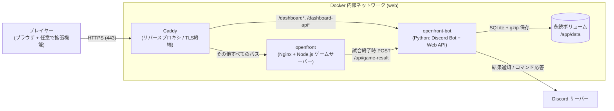

# OpenFront プライベートサーバー・インフラ構成説明書

このドキュメントは、仲間内向けの OpenFrontIO プライベートサーバー（`openfront.dk-core.com`）のシステム構成、各サービスの役割、およびデータフローをまとめた説明資料です。

---

## 1. 全体構成図

---

## 2. 各コンポーネントの役割

| サービス | 技術スタック | 役割 |
| :--- | :--- | :--- |
| **Caddy** | Caddy | HTTPS（自動 TLS）の終端と、URL パスに応じた各コンテナへのルーティング。外部には `80` / `443` のみ公開。 |
| **openfront** | Node.js 24 + Nginx + Vite | OpenFrontIO ゲーム本体。Master + Worker 構成で対戦ルームをホスト。広告スクリプトは無効化済み。 |
| **openfront-bot** | Python 3.12 + `discord.py` + `aiohttp` + `aiosqlite` | 試合結果の集計・保存、Discord Bot 機能、戦績ダッシュボード Web UI、リプレイ配信・AI 分析エクスポート API を提供。 |

---

## 3. URL・機能一覧（`openfront.dk-core.com`）

| エンドポイント / 機能 | 説明 |
| :--- | :--- |
| **`https://openfront.dk-core.com/`** | OpenFront ゲーム本体。プレイ中は拡張機能向けブリッジ `window.__openfrontBridge` が有効。 |
| **`https://openfront.dk-core.com/dashboard`** | 戦績 & リプレイダッシュボード（ランキング表・プレイヤー検索・試合履歴）。 |
| **`https://openfront.dk-core.com/#replay-viewer=<gameID>`** | 過去の試合のリプレイ再生（ブラウザ上のゲームエンジンで操作履歴を再シミュレーション）。 |
| **`/dashboard/api/export/<gameID>?format=ai`** | 試合の戦況サマリー（統計・主要イベントタイムライン）を AI 分析用 Markdown として出力。 |
| **`/dashboard/api/export/<gameID>?format=raw`** | リプレイ元データ（`GameRecord` JSON）をそのままダウンロード。 |

### Discord Bot スラッシュコマンド
- `/ranking`: 通算勝利数ランキングトップ 10 を表示（ダッシュボードリンク付き）
- `/stats <username>`: 指定プレイヤーの勝敗・勝率を表示
- `/history`: 直近 5 件の試合履歴を表示
- `/set-channel`: 試合結果の自動通知先チャンネルを設定（管理者権限が必要）

---

## 4. データ管理とパフォーマンス設計

### データの永続化（`openfront-bot`）
- **戦績データベース**: `/app/data/matches.db`（SQLite）に試合メタデータ・プレイヤー別勝敗を保存。
- **リプレイファイル**: `/app/data/replays/<gameID>.json.gz` に `GameRecord` JSON を gzip 圧縮して保存（DB の肥大化・ロックを防止）。

### ゲームプレイへの負荷対策
1. **リアルタイム拡張機能ブリッジ（`window.__openfrontBridge`）**
   - クライアントメモリ上の `GameView` を拡張機能から呼ばれたときだけ読む **Pull 型** 設計のため、拡張機能を使わないユーザー（モバイル回線など）への通信負荷・CPU 負荷はゼロです。
2. **非同期結果送信 & コンテナ分離**
   - 試合結果の送信は試合終了時に非同期（`fetch`）で実行され、ダッシュボードや AI エクスポートの処理は別コンテナ（`openfront-bot`）で動くため、プレイ中のラグには影響しません。

---

## 5. 本家（`openfrontio/OpenFrontIO`）との保守方針

本家アップデート時のマージコンフリクトを最小限に抑えるため、OpenFrontIO 本体への独自変更は以下の最小範囲に限定しています：
- **広告無効化**: `index.html`, `src/client/Main.ts`
- **試合結果・リプレイ送信**: `src/server/Archive.ts`（`BOT_API_URL` への POST）
- **リプレイ取得先分岐**: `src/client/replay/ReplayRecord.ts`（`openfront.dk-core.com` 上のみ `/dashboard-api` を参照）
- **拡張機能ブリッジ**: `src/client/ExtensionBridge.ts`（独立ファイル）+ `src/client/ClientGameRunner.ts`（登録/解除の最小フック）

ダッシュボード UI や集計ロジックはすべて `openfront-bot` 側に分離しているため、本家の画面や機能が大きく更新されても干渉しにくい構成になっています。
